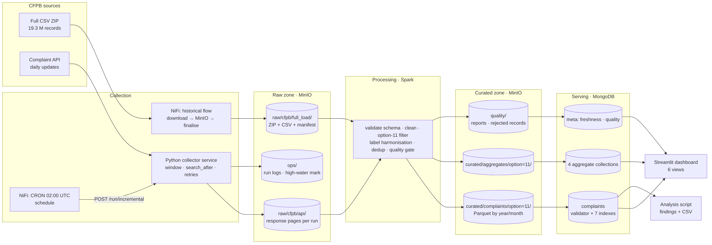

# Public Banking Complaints Data Platform — Option 11: Payday lending

020IABDM2 Big Data Frameworks · Hands-on Master's project

A reproducible data platform that collects the public **CFPB Consumer Complaint Database**, preserves the source data, processes it with **Apache Spark**, serves it from **MongoDB** and presents findings in a **Streamlit** dashboard — for **payday-loan complaints** (option 11).

> **Project question:** how can a small data engineering team turn public complaint records into useful evidence while making clear what those records can and cannot tell us?

---

## 1. Architecture



| Layer | Tool | Where |
|---|---|---|
| Collection (historical) | Apache NiFi flow *CFPB historical load* | `ingestion/nifi/historical_flow.json`, `ingestion/historical_collector.py` |
| Collection (incremental, daily) | Python collector service, scheduled by NiFi *CFPB incremental schedule* | `ingestion/incremental_collector.py`, `ingestion/pipeline.py`, `ingestion/service.py`, `ingestion/nifi/incremental_flow.json` |
| Raw zone | MinIO bucket `raw` | `raw/cfpb/full_load/…`, `raw/cfpb/api/…` |
| Processing | Spark (PySpark, local mode) | `processing/` |
| Curated zone | Parquet in MinIO bucket `curated` | `curated/complaints/option=11/year=YYYY/month=MM/` |
| Serving | MongoDB database `cfpb` | `database/` |
| Analysis | Python + pandas | `analytics/analysis.py` → `docs/findings.md` |
| Dashboard | Streamlit | `dashboard/` |

Design details: `docs/architecture.md`, `docs/processing_rules.md`, `docs/mongodb_design.md`, `docs/incremental_design.md`, `docs/dashboard_views.md`.

### Option 11 scope
Payday loans appear under three non-overlapping CFPB labels; all three are included (`config/scope_option11.json`):

| Period | Product | Sub-product | Records (20 Nov 2026) |
|---|---|---|---|
| 2013–2017 | Payday loan | — | 5,528 |
| 2017–2023 | Payday loan, title loan, or personal loan | Payday loan | 6,963 |
| 2023–now | Payday loan, title loan, personal loan, or advance loan | Payday loan | 6,552 |

The raw zone keeps the **full** archive (19,316,897 records, all products); Spark applies the scope.

---

## 2. Prerequisites (Windows)

| Software | Check | Install |
|---|---|---|
| WSL 2 | `wsl --status` | `wsl --install` (admin PowerShell), then restart |
| Git | `git --version` | `winget install -e --id Git.Git` |
| Docker Desktop (WSL 2 engine) | `docker compose version` | `winget install -e --id Docker.DockerDesktop` |
| VS Code (optional) | `code --version` | `winget install -e --id Microsoft.VisualStudioCode` |
| MongoDB Compass (optional) | — | `winget install -e --id MongoDB.Compass.Community` |

Hardware: 16 GB RAM recommended (8 GB works), **≥ 30 GB free disk** (the extracted CSV is 5.86 GB and is stored in MinIO and in NiFi's repository). Give Docker memory in `%USERPROFILE%\.wslconfig`:

```ini
[wsl2]
memory=10GB
processors=4
```

Nothing else is installed on Windows: MinIO, MongoDB, NiFi, Java, Spark and all Python libraries run in containers.

---

## 3. Setup from an empty environment

```powershell
git clone https://github.com/MikeDrn/cfpb-complaints-platform.git
cd cfpb-complaints-platform
Copy-Item .env.example .env          # then edit the two passwords (see below)
docker compose build                  # first time: 5–10 min
docker compose up -d
docker compose ps                     # minio, mongo, nifi, collector, dashboard = Up
```

`.env` rules: MinIO password ≥ 8 characters; Mongo password letters and digits only, repeated inside `MONGO_URI`. `.env` is never committed.

| Service | URL | Login |
|---|---|---|
| MinIO console | http://localhost:9001 | `MINIO_ROOT_USER` / `MINIO_ROOT_PASSWORD` |
| NiFi | http://localhost:8080/nifi | none (local HTTP) |
| Collector API | http://localhost:8001/health (inside Docker: `http://collector:8000`) | — |
| Dashboard | http://localhost:8501 | — |
| MongoDB (Compass) | `mongodb://admin:<password>@localhost:27017/?authSource=admin` | — |

---

## 4. Running the platform

### 4.1 Historical load (once, or monthly to pick up revisions of older records)
**NiFi (preferred):** NiFi → *CFPB historical load* → start all processors except the trigger → right-click `1 Trigger` → **Run Once**. If the group is missing: drag *Process Group* → upload `ingestion/nifi/historical_flow.json`, then re-enter the MinIO secret key in `4 Save to MinIO` (NiFi never exports secrets).

**Python (same result, for reproducibility):**
```powershell
docker compose run --rm jobs python -m ingestion.historical_collector
```
Result: `raw/cfpb/full_load/ingest_date=YYYY-MM-DD/` with `complaints.csv.zip`, `complaints.csv`, `manifest.json` (URL, timestamp, sizes, SHA-256, record count). A second run on the same day is refused: raw data is immutable.

### 4.2 Processing, serving and analysis after a full load
```powershell
docker compose run --rm jobs python -m processing.profile_raw    --ingest-date YYYY-MM-DD   # optional profile
docker compose run --rm jobs python -m processing.run_processing --mode full --ingest-date YYYY-MM-DD
docker compose run --rm jobs python -m database.load_mongo       --run-id full_YYYY-MM-DD
docker compose run --rm jobs python -m database.queries                    # docs/query_results.md
docker compose run --rm jobs python -m database.queries --benchmark        # docs/index_benchmark.md
docker compose run --rm jobs python -m analytics.analysis                  # docs/findings.md + analytics/outputs/
```

### 4.3 Scheduled incremental ingestion
- **Schedule:** NiFi *CFPB incremental schedule*, GenerateFlowFile **CRON `0 0 2 * * ?`** (daily 02:00 UTC) → `POST http://collector:8000/run/incremental`.
- **One run =** collect `[high-water mark − 21 days, today]` → Spark incremental → MongoDB load → commit new high-water mark (only after success).
- **Manual trigger (same code):** NiFi → right-click `1 Daily trigger` → **Run Once**, or
  ```powershell
  docker compose run --rm jobs python -m ingestion.pipeline
  ```
- **Replay a bounded window** (does not move the high-water mark):
  ```powershell
  docker compose run --rm jobs python -m ingestion.pipeline --start 2026-11-10 --end 2026-11-19
  ```

### 4.4 Where to find the evidence of a run
| Evidence | Location |
|---|---|
| Run log (window, parameters, pagination, retries, raw paths, counts, status) | `ops/runs/run_id=<id>/run.json` |
| Raw API responses | `raw/cfpb/api/ingest_date=…/run_id=<id>/response_<day>_<page>.json` |
| Processing summary | `ops/runs/run_id=<id>/processing.json` |
| Quality report and rejected records | `quality/run_id=<id>/quality_report.json`, `…/rejected/` |
| High-water mark | `ops/state/option=11/watermark.json` |
| Freshness and reconciliation in MongoDB | collection `meta`, documents `freshness` and `quality_latest` |

---

## 5. Tests

```powershell
docker compose run --rm jobs pytest -q                      # unit tests (no services needed)
docker compose run --rm jobs pytest -q -m integration       # MongoDB tests (mongo container running)
docker compose run --rm jobs python -m processing.make_sample --ingest-date YYYY-MM-DD   # once
docker compose run --rm jobs pytest -q -m e2e               # sample → MinIO → Spark → MongoDB → dashboard
```

| Area (brief §10) | Tests |
|---|---|
| Collector | `tests/test_incremental_collector.py` — known window, pagination, timeout, HTTP failure, empty response, repeated request, high-water mark |
| Spark transformation | `tests/test_transform.py` — invalid dates, missing values, option filter, historical labels, duplicates |
| Data quality | `tests/test_quality.py` — required fields, uniqueness, reconciliation, thresholds |
| MongoDB | `tests/test_mongo.py` — safe upserts, unique `_id`, validator, aggregates, index use |
| Dashboard | `tests/test_dashboard.py` — empty selection, invalid range, missing category, database down, layout |
| End to end | `tests/test_end_to_end.py` — counts reconciled at each stage |

Defects found and corrected: `docs/defects.md`.

---

## 6. Stop, reset and recover

```powershell
docker compose stop                 # stop, keep all data
docker compose start                # start again
docker compose down                 # remove containers, keep data volumes
docker compose down -v              # FULL RESET: deletes MinIO, MongoDB and NiFi data
docker compose logs -f collector    # follow a service's log (Ctrl+C to leave)
```

| Situation | What to do |
|---|---|
| A scheduled run failed | Read `ops/runs/run_id=<id>/run.json` (`status`, `error`, `failed_on_day`). The high-water mark did not move, so the next run repeats the window. Fix the cause, then trigger manually. |
| Quality gate failed | Curated data was **not** published. Open the report's failing check and the `rejected/` folder; fix the cause; rerun `processing.run_processing`. |
| Curated and MongoDB counts differ | `load_mongo` stops with "Reconciliation failed". Rerun `database.load_mongo --run-id <last run>`. |
| MongoDB lost / reset | `docker compose up -d`, then `database.load_mongo --run-id <last run>` (rebuilds from curated). |
| Curated layer lost | Rerun `processing.run_processing --mode full --ingest-date <latest full load>`, then the loader. |
| Everything lost | Section 3, then 4.1 and 4.2. |
| Older records revised by the CFPB | Run a new historical load (new `ingest_date`), then the full processing. |

---

## 7. Troubleshooting

| Symptom | Fix |
|---|---|
| `pull access denied for minio/minio` | MinIO left Docker Hub; the Compose file uses `cgr.dev/chainguard/minio`. |
| `port is already allocated` | Another container uses the port: `docker ps -a --filter "publish=8501"`, then `docker stop <name>` and `docker update --restart=no <name>`. Never `taskkill` the PID shown by netstat (it is Docker's own proxy). |
| `failed to connect to the docker API` | Docker Desktop is not running; start it and wait for *Engine running*. |
| NiFi `UnknownHostException` | DNS inside Docker; `dns:` is set in Compose. Check: `docker compose exec nifi getent ahostsv4 files.consumerfinance.gov`. |
| NiFi download gets "Access Denied" | Set *Request User-Agent* `curl/8.5.0` and add property `Accept` = `*/*` on the InvokeHTTP processor. |
| NiFi finalise: `collector: Name or service not known` | Collector not running: `docker compose ps collector` must show a growing "Up" time. |
| MongoDB `Authentication failed` | Password differs from the one used when the volume was created; check `.env`. |
| Build times out on `pip install` | Slow network; rerun. Test-only packages are in `requirements-dev.txt` so the large layer stays cached. |
| Spark `ClassNotFoundException: S3AFileSystem` | First Spark run needs internet to download the S3 connector (cached afterwards in the `ivy_cache` volume). |

---

## 8. Repository layout

```
ingestion/    collectors, pipeline, collector service, nifi/ flow exports
processing/   Spark session, schema, transformations, quality, jobs, profiling, sampling
database/     document model, indexes, loader, queries and benchmark
analytics/    analysis script, outputs/ (CSV)
dashboard/    Streamlit app and data access
tests/        unit, integration and end-to-end tests, data/ sample
config/       settings, option scope, issue mapping, quality thresholds, baselines
docs/         design notes, data dictionary, API notes, findings, quality and query evidence, defects, demo script
docker/       platform image
docker-compose.yml · requirements.txt · requirements-dev.txt · .env.example · pytest.ini
```

The full source dataset is never committed to Git; it lives in MinIO.

## 9. Data source and responsible use
CFPB Consumer Complaint Database (public domain, CC0). Counts describe **published complaints**, not borrowers, loans, fraud or harm; company figures are not quality rankings; state figures are not population-adjusted; the timely flag is not satisfaction; receipt-to-referral days are not resolution time. The dashboard shows aggregates only. See `docs/findings.md` and the dashboard's *Data quality & limitations* view.
