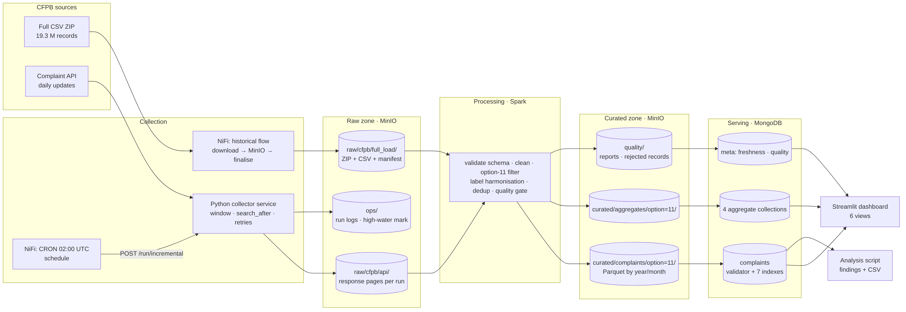

# Architecture

Source of the diagram: `docs/architecture.mmd` (Mermaid).

| Layer | Tool | Responsibility | Why this tool |
|---|---|---|---|
| Collection — historical | Apache NiFi | Download the official ZIP, land it in MinIO, call the finalise step (checksum, extraction, record count, manifest) | Lecturer's preferred tool; visual, scheduled flows with data provenance |
| Collection — incremental | Python service + NiFi CRON | Daily window from the high-water mark with 21-day overlap, cursor pagination, bounded retries, run log | API logic is easier to unit-test in Python; NiFi owns *when* it runs |
| Raw zone | MinIO | Immutable original files and API responses by ingestion date and run | S3-compatible, light, enterprise-grade; simpler than HDFS on a laptop |
| Processing | Apache Spark (PySpark) | Schema validation, cleaning, option filter, label harmonisation, dedup, quality gate, aggregates | Handles the 5.86 GB / 19.3 M-row archive; same code scales to a cluster |
| Curated zone | Parquet + Snappy in MinIO | Clean complaint records by year/month; dashboard aggregates; quality reports | Columnar, compressed, splittable, keeps the schema |
| Serving | MongoDB | Complaint documents, aggregates, freshness and quality metadata | Document model, indexes and aggregation pipelines match the dashboard queries |
| Analysis | Python + pandas | Reproducible findings with definitions and cautions | Small curated scope (≈19,000 records) fits in memory |
| Visualisation | Streamlit + Plotly | Six views for analysts, freshness and limitations | Required by the brief; Python end to end |
| Operations | Docker Compose + GitHub | One command to start; pinned versions; tests | Reproducible on every team member's laptop |

**Not used, on purpose:** Kafka (no real-time requirement), HDFS (heavier than MinIO for this size), Sqoop (no relational source).
